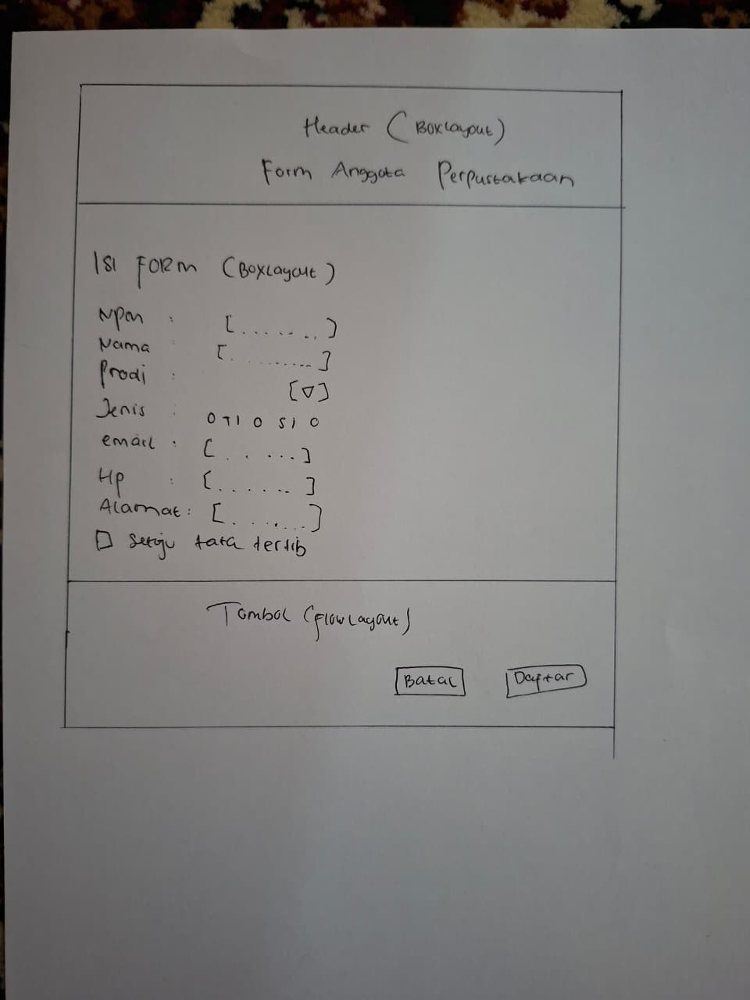

# P04 - Layout Manager

## Tabel Rancangan FormAnggotaPerpustakaan

| Bagian | Panel | Layout |
|---|---|---|
| Jendela | JFrame | BorderLayout |
| Header | headerPanel | BoxLayout (Y Axis) |
| Isi form | isiPanel → formPanel | BorderLayout → GridBagLayout |
| Tombol | tombolPanel | FlowLayout (Right) |

## Jawaban Eksperimen Praktikum 2

1. Pada flowPanel, Alignment diubah jadi Center lalu jendela diperkecil: posisi tombol yang sebelumnya rata kiri berubah jadi rata tengah, termasuk baris terakhir yang tersisa. Baris yang berubah di initComponents() adalah parameter FlowLayout.LEFT yang berubah jadi FlowLayout.CENTER.

2. Pada gridPanel, Rows diubah jadi 0 dan Columns jadi 2: terbentuk 5 baris. GridLayout menghitung otomatis jumlah baris berdasarkan jumlah kolom dan total 9 komponen (9 dibagi 2 dibulatkan ke atas menjadi 5 baris).

3. Pada boxPanel, maximumSize keempat tombol diisi lebar 32767: tombol menjadi melebar penuh mengikuti lebar panel, tidak lagi hanya selebar teksnya, karena BoxLayout menghormati nilai maximumSize komponen.

## Jawaban Eksperimen Praktikum 4

1. Weight X pada namaField diubah jadi 0.0, jendela dilebarkan: tidak terlihat perbedaan karena kolom isian dipakai bersama banyak baris lain yang Weight X-nya masih 1.0, sehingga lebar kolom tetap mengikuti baris-baris tersebut.

2. Direction formPanel di isiPanel diubah dari North ke Center, jendela ditinggikan: form yang tadinya menempel rapi di atas sekarang ikut diposisikan di tengah secara vertikal, muncul gap kosong di antara headerPanel dan formPanel.

3. Baris setMinimumSize(getSize()) dihapus, jendela dikecilkan sekecil mungkin: komponen-komponen ikut menyusut tanpa batas, bagian yang dikecilkan lebih dulu (misalnya bagian bawah atau samping yang ditarik) langsung terpotong/rusak mengikuti ukuran jendela yang dipaksakan.

## Tahap 4: Saling Menilai

| No | Pemeriksaan | Ya/Belum |
|---|---|---|
| 1 | Label singkat, jelas, dan sejajar | Ya |
| 2 | Isian dikelompokkan dengan judul bagian | Ya |
| 3 | Placeholder dipakai untuk isian yang punya format | Ya |
| 4 | Komponen sesuai jenis data | Ya |
| 5 | Tombol utama menonjol dan berada di kanan bawah | Ya |
| 6 | Jarak antar komponen konsisten | Ya |
| 7 | Form tetap rapi saat jendela dilebarkan dan ditinggikan | Ya |
| 8 | Tampilan dibuat dengan JFrame Form dan layout manager | Ya |

Saran: 

## Pertanyaan Refleksi

1. Mengapa Null Layout dan Absolute Layout sebaiknya dihindari?
Keduanya memakai posisi piksel tetap sehingga tampilan tidak menyesuaikan ukuran jendela, teks bisa terpotong pada skala layar berbeda, dan Absolute Layout butuh library tambahan sehingga aplikasi sulit dijalankan di komputer lain.

2. Jelaskan perbedaan perilaku FlowLayout dan GridLayout saat jendela dilebarkan.
FlowLayout mempertahankan ukuran asli tiap komponen dan hanya mengatur ulang posisi berdasarkan ruang yang tersedia (pindah baris jika tidak muat). GridLayout membagi semua sel sama besar, sehingga seluruh komponen ikut melebar merata mengikuti ukuran jendela.

3. Apa fungsi Weight X dan Fill pada constraint GridBagLayout?
Weight X menentukan seberapa besar sisa ruang kosong dialokasikan ke kolom tersebut, sedangkan Fill menentukan apakah komponen melebar mengisi selnya (Horizontal, Vertical, atau Both).

4. Mengapa formPanel dibungkus isiPanel dan diletakkan di North?
Supaya baris-baris form tetap menempel di bagian atas dan tidak ikut melebar/bergeser ke bawah saat jendela ditinggikan, sehingga form tetap rapi.

5. Sebutkan dua prinsip desain yang diterapkan pada Form Anggota Perpustakaan dan buktinya.
Keselarasan: semua label dan isian membentuk garis lurus di kolom yang sama (Grid X=0 untuk label, Grid X=1 untuk isian). Kedekatan: isian dikelompokkan dengan judul bagian "Data Anggota" dan "Kontak" yang memisahkan jenis data secara visual.

## Deklarasi Penggunaan AI

Saya menggunakan Claude (Anthropic) sebagai asisten untuk membantu memahami konsep layout manager (BorderLayout, FlowLayout, GridLayout, BoxLayout, GridBagLayout), memandu langkah-langkah penggunaan GUI Builder NetBeans, membantu debugging error pada kode. Seluruh form (GaleriLayout, FormBiodata, FormAnggotaPerpustakaan) saya susun dan buat sendiri langsung di NetBeans mengikuti arahan tersebut.

## Foto Tangkapan Layar
# P04 - Layout Manager

## 1. Sebelum Dilebarkan

## 2. Setelah Dilebarkan

## 3. Sketsa

## 4. Tampilan Full

