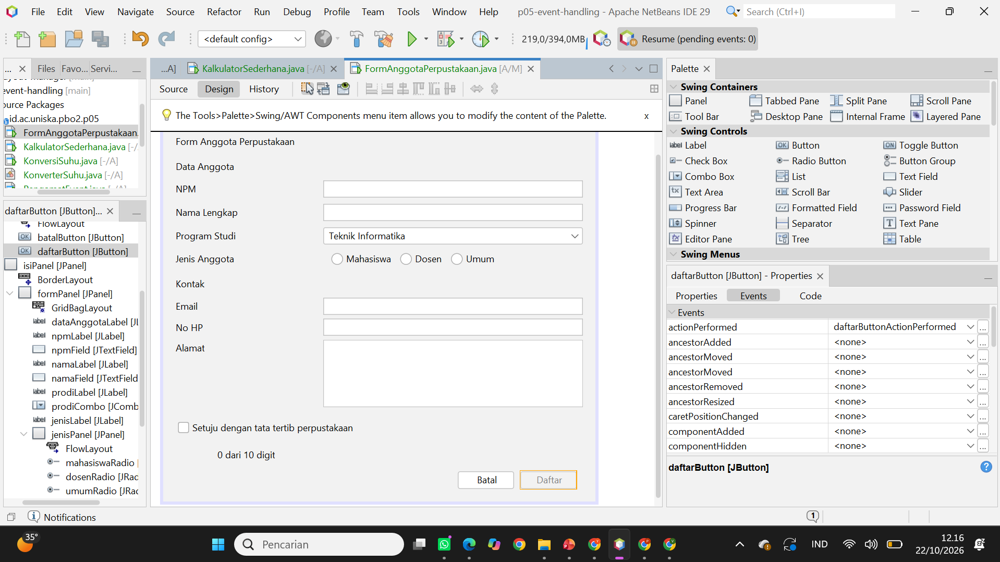
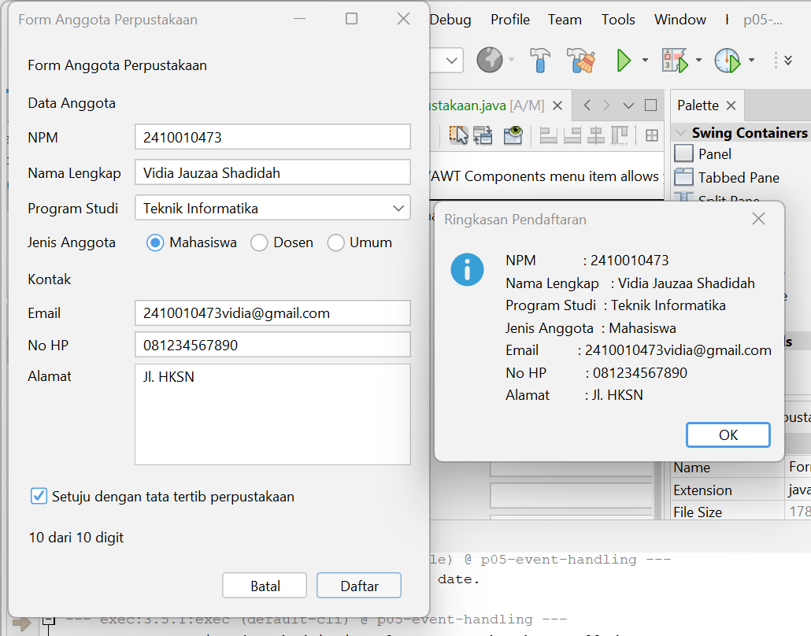
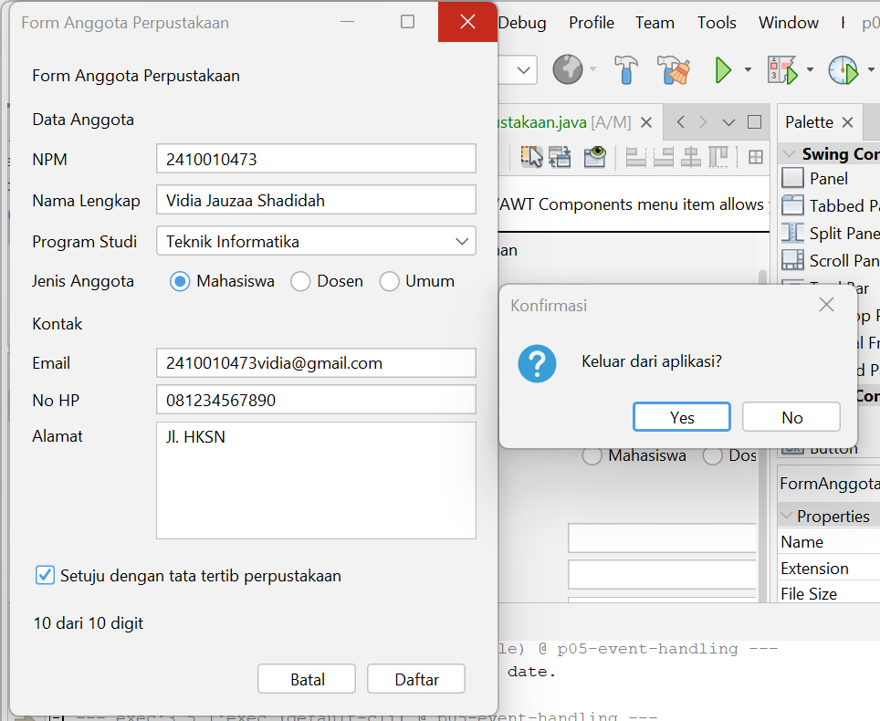

# P05 - Event Handling

**Mata Kuliah:** Pemrograman Berbasis Objek 2 (TIF1508)
**Pertemuan:** 5 - Event Handling
**Nama:** Vidia Jauzaa Shadidah
**NPM:** 2410010473

Proyek Maven `p05-event-handling` (package `id.ac.uniska.pbo2.p05`) berisi empat JFrame Form (masing-masing dengan file `.java` dan `.form`) dan satu kelas logika biasa:

| File | Keterangan |
|---|---|
| `PengamatEvent` | Praktikum 2, mengamati event |
| `KonverterSuhu` | Praktikum 3, kelas logika tanpa GUI |
| `KonversiSuhu` | Praktikum 3, konversi suhu |
| `KalkulatorSederhana` | Praktikum 4, kalkulator dengan tiga cara menghubungkan event |
| `FormAnggotaPerpustakaan` | Latihan mandiri, form yang sudah memiliki event |

---

## 1. Tabel Pengamatan Praktikum 2

| No | Tindakan | Event yang tercatat |
|----|----------|---------------------|
| 1 | Arahkan kursor ke tombol, lalu jauhkan | `MouseEvent` kursor masuk ke tombol, lalu `MouseEvent` kursor keluar dari tombol |
| 2 | Klik tombol Klik saya | `MouseEvent` kursor masuk ke tombol, `ActionEvent` tombol diklik, lalu `MouseEvent` kursor keluar dari tombol saat kursor menjauh |
| 3 | Centang lalu hapus centang Aktifkan fitur | `ItemEvent` kotak dicentang, lalu `ItemEvent` centang dihapus |
| 4 | Ganti pilihan dari Pagi menjadi Malam | `ItemEvent` memilih Malam (hanya satu baris karena ada pemeriksaan `SELECTED`) |
| 5 | Klik isian, lalu ketik kata "abc" | `FocusEvent` isian mendapat fokus, lalu `KeyEvent` mengetik huruf a, b, dan c |
| 6 | Klik tombol setelah mengetik di isian | `MouseEvent` kursor masuk ke tombol, `FocusEvent` isian kehilangan fokus, lalu `ActionEvent` tombol diklik |

---

## 2. Jawaban Eksperimen Praktikum 3 (Konversi Suhu)

**Eksperimen 1: menghapus pemeriksaan `ItemEvent.SELECTED`**

Pesan `item berubah` tercetak **2 kali** setiap pilihan diganti. Hal ini terjadi karena `itemStateChanged` pada Combo Box dipanggil dua kali: sekali untuk pilihan lama (`DESELECTED`) dan sekali untuk pilihan baru (`SELECTED`). Karena itu aksi perlu dibatasi dengan `evt.getStateChange() == ItemEvent.SELECTED`.

**Eksperimen 2: mengganti `keyReleased` dengan `keyPressed`**

Hasil yang tampil terlambat satu karakter. `keyPressed` dipanggil saat tombol baru ditekan, sebelum karakternya dimasukkan ke text field, sehingga `getText()` di dalam `konversi()` masih membaca isi lama. Pada `keyReleased`, tombol sudah dilepas dan karakter sudah masuk ke field, sehingga hasilnya sesuai dengan isian terbaru.

**Eksperimen 3: menghapus blok `try` dan `catch`**

Saat huruf diketik di isian, jendela Output menampilkan `java.lang.NumberFormatException: For input string: "..."` beserta stack trace, dan label hasil tidak diperbarui. `Double.parseDouble` tidak dapat mengubah huruf menjadi angka, dan tanpa `catch` kesalahan itu tidak ditangani sehingga pengguna tidak mendapat pesan apa pun.

---

## 3. Jawaban Eksperimen Praktikum 4 (Kalkulator Sederhana)

**Eksperimen 1: event ganda pada tombol x**

Pesan `kali` tercetak **2 kali** untuk satu klik. Tombol memiliki dua listener: satu dibuat GUI Builder di `initComponents()` dan satu lagi berupa lambda di konstruktor. Keduanya terdaftar sehingga sama-sama dijalankan. Satu tombol sebaiknya memakai satu cara saja agar aksinya tidak berjalan ganda, yang dapat menimbulkan masalah pada aksi yang mengubah data, misalnya data tersimpan dua kali.

**Eksperimen 2: menambah tombol %**

- **Tab Design:** menambah tombol `modButton` bertuliskan `%` ke `operatorPanel`, mengubah jumlah kolom Grid Layout dari 4 menjadi 5, lalu membuat event `actionPerformed` melalui Events.
- **Tab Source:** mengisi `modButtonActionPerformed` dengan `hitung('%');`, menambah `case '%' -> a % b;` pada `switch`, dan menyesuaikan pengecekan pembagi nol menjadi `(operator == '/' || operator == '%') && b == 0`.

**Eksperimen 3: kursor setelah tombol Hapus**

Kursor langsung berada di isian pertama karena baris terakhir method `hapus()` memanggil `angka1Field.requestFocusInWindow();`. Perintah itu meminta fokus keyboard dipindahkan ke `angka1Field`, sehingga pengguna dapat langsung mengetik angka baru tanpa mengklik isian terlebih dahulu.

---

## 4. Peta Event FormAnggotaPerpustakaan

| Komponen | Menu Events | Aksi |
|----------|-------------|------|
| Kotak centang `setujuCheck` | Item: `itemStateChanged` | Tombol Daftar hanya aktif jika dicentang |
| Tombol `batalButton` | Action: `actionPerformed` | Mengosongkan semua isian dan mengembalikan fokus ke NPM |
| Tombol `daftarButton` | Action: `actionPerformed` | Menampilkan ringkasan data dengan `JOptionPane` |
| Isian `npmField` | Key: `keyReleased` | Label `digitLabel` menampilkan jumlah digit, misalnya "8 dari 10 digit" |
| Form (JFrame di Navigator) | Window: `windowClosing` | Meminta konfirmasi sebelum aplikasi ditutup |

Pengaturan Properties: `defaultCloseOperation` form = `DO_NOTHING`, dan properti `enabled` tombol Daftar tidak dicentang pada awalnya.

Logika penghitungan digit ditulis sekali di method `perbaruiJumlahDigit()`, lalu dipanggil dari konstruktor, event `keyReleased` NPM, dan tombol Batal, sehingga kode tidak berulang.

---

## 5. Tangkapan Layar

### Jendela Properties bagian Events untuk tombol Daftar

### Dialog ringkasan

### Dialog konfirmasi keluar

---

## 6. Deklarasi Penggunaan AI

Saya menggunakan **Claude (Anthropic)** untuk memahami langkah pengerjaan tugas berdasarkan modul, membantu menyusun kode event handler, menjelaskan hasil eksperimen, dan menyusun kerangka README ini. Seluruh kode saya jalankan dan uji sendiri, dan hasil pengamatan diambil dari aplikasi yang saya jalankan.
