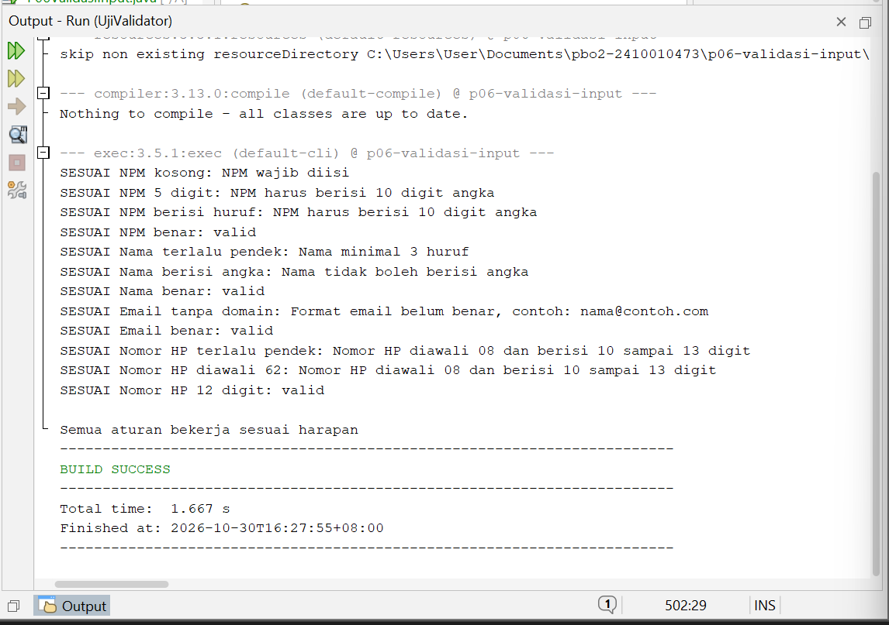
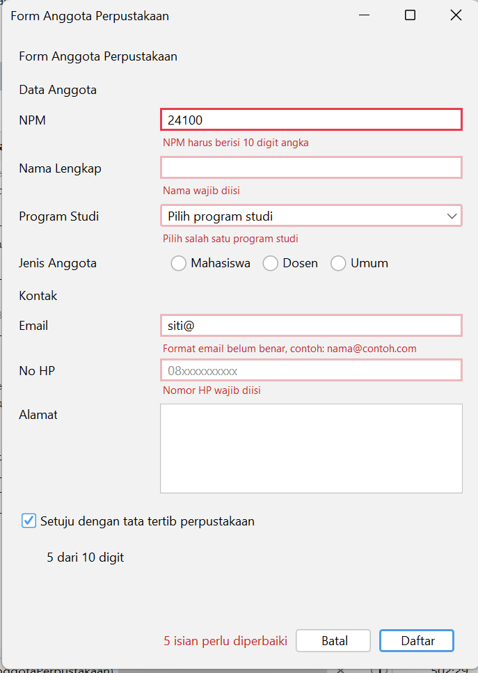
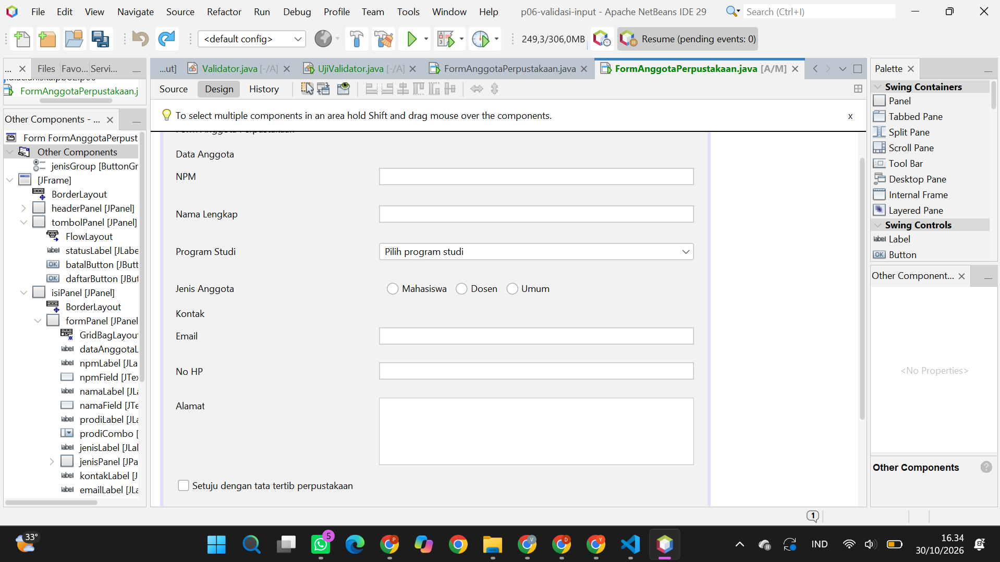
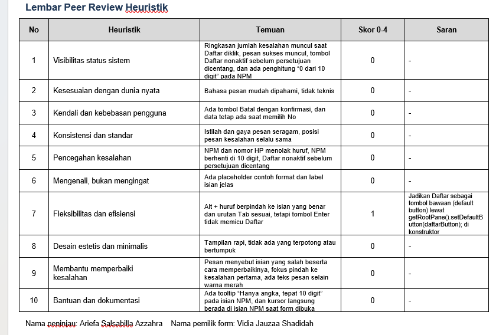

# P06 - Validasi Input dan Kegunaan

**Mata Kuliah:** Pemrograman Berbasis Objek 2 (TIF1508)
**Pertemuan:** 6 - Validasi Input dan Kegunaan
**Nama:** Vidia Jauzaa Shadidah
**NPM:** 2410010473

Proyek Maven `p06-validasi-input` (package `id.ac.uniska.pbo2.p06`) berisi:

| File | Keterangan |
|---|---|
| `Validator.java` | Kelas biasa berisi aturan validasi NPM, nama, email, dan nomor HP tanpa GUI |
| `UjiValidator.java` | Pengujian aturan `Validator` dengan contoh masukan benar dan salah |
| `FormAnggotaPerpustakaan.java` dan `.form` | JFrame Form Anggota Perpustakaan yang sudah divalidasi |

---

## 1. Pengujian Aturan Validasi (UjiValidator)

Semua baris keluaran bertanda `SESUAI`, termasuk aturan tambahan "nama tidak boleh berisi angka".

---

## 2. Tangkapan Layar Form dengan Pesan Kesalahan

Form setelah tombol **Daftar** diklik dengan data yang salah. Isian yang salah diberi garis merah, pesan tampil tepat di bawah isian, ringkasan jumlah kesalahan tampil di dekat tombol, dan fokus berpindah ke kesalahan pertama (NPM).

---

## 3. Tangkapan Layar Jendela Navigator (Label Pesan)

Kelima label pesan (`npmPesanLabel`, `namaPesanLabel`, `prodiPesanLabel`, `emailPesanLabel`, `hpPesanLabel`) berada di `formPanel`, tepat di bawah isiannya pada GridBagLayout. `statusLabel` berada di `tombolPanel`.

---

## 4. Jawaban Eksperimen Praktikum 4

**Eksperimen 1: mengetik huruf pada isian NPM**

Huruf tidak masuk ke isian NPM. Penyebabnya baris `evt.consume();` di dalam `npmFieldKeyTyped`. Baris itu dijalankan ketika kondisi `!Character.isDigit(evt.getKeyChar())` bernilai true, yaitu ketika karakter bukan angka, sehingga karakter dibatalkan sebelum masuk ke isian. Kondisi `penuh` juga memakai `consume()` untuk menolak digit ke-11.

**Eksperimen 2: email `siti@`, lalu Tab**

Pesan kesalahan dan garis merah muncul setelah Tab ditekan, yaitu saat fokus meninggalkan isian email. Hal ini karena pemeriksaan dipasang pada event `focusLost` (`emailFieldFocusLost`), bukan saat mengetik, sehingga pengguna tidak ditegur ketika email belum selesai diketik.

**Eksperimen 3: klik isian Nama tanpa mengetik, lalu Tab**

Tidak ada pesan kesalahan karena `namaFieldFocusLost` hanya memeriksa isian yang tidak kosong, lewat kondisi `if (!namaField.getText().isBlank())`. Isian kosong baru diperiksa saat tombol Daftar diklik, agar isian tidak langsung ditandai merah hanya karena pengguna melewatinya sebelum sempat mengetik.

**Eksperimen 4: centang persetujuan, lalu klik Daftar dengan form kosong**

Isian NPM yang mendapat fokus. Method `daftar()` mengumpulkan semua isian yang salah ke dalam daftar `salah`, lalu memanggil `salah.get(0).requestFocusInWindow()` untuk memindahkan fokus ke kesalahan pertama. NPM adalah isian pertama yang diperiksa.

**Eksperimen 5: menekan Alt + N**

Isian Nama Lengkap (`namaField`) yang mendapat fokus. Properti yang mengaturnya adalah `displayedMnemonic = N` pada `namaLabel`, dipadukan dengan `labelFor = namaField`. Saat Alt+N ditekan, fokus dipindahkan ke komponen yang ditunjuk `labelFor`.

**Eksperimen 6: mengisi beberapa isian, klik Batal, lalu pilih No**

Data tetap ada. Method `batal()` menampilkan konfirmasi jika `adaIsian()` bernilai true. Bila jawabannya bukan `YES_OPTION`, method langsung `return` sehingga `kosongkan()` tidak dijalankan. Konfirmasi diberikan karena aksi tersebut menghapus data.

---

## 5. Peer Review

### 5.1 Lembar peer review yang saya terima

Dinilai oleh: (Ariefa Salsabilla Azzahra)

### 5.2 Tabel temuan dan perbaikan

| No | Heuristik | Temuan | Skor 0-4 | Saran |
|----|-----------|-------------------|------|------------------------------|
| 1 | Visibilitas status sistem |Ringkasan jumlah kesalahan muncul saat Daftar diklik, pesan sukses muncul, tombol Daftar nonaktif sebelum persetujuan dicentang, dan ada penghitung “0 dari 10 digit” pada NPM| 0 | - |
| 2 | Kesesuaian dengan dunia nyata | Bahasa pesan mudah dipahami, tidak teknis | 0 | - |
| 3 | Kendali dan kebebasan pengguna | Istilah dan gaya pesan seragam, posisi pesan kesalahan selalu sama| 0 | - |
| 4 | Konsistensi dan standar | Istilah dan gaya pesan seragam, posisi pesan kesalahan selalu sama | 0 | - |
| 5 | Pencegahan kesalahan | NPM dan nomor HP menolak huruf, NPM berhenti di 10 digit, Daftar nonaktif sebelum persetujuan dicentang | 0 | - |
| 6 | Mengenali, bukan mengingat | Ada placeholder contoh format dan label isian jelas | 0 | - |
| 7 | Fleksibilitas dan efisiensi | Alt + huruf dan urutan Tab sudah sesuai, tetapi tombol Enter tidak memicu Daftar | 1 | `hpField` memiliki ActionListener kosong yang membuat Enter di isian No HP tidak diteruskan ke tombol bawaan. Event itu dihapus lewat Events, sehingga Enter menjalankan Daftar dari semua isian. Daftar tetap menjadi tombol bawaan lewat `getRootPane().setDefaultButton(daftarButton);` | `b832d1e` |
| 8 | Desain estetis dan minimalis | Tampilan rapi, tidak ada yang terpotong atau bertumpuk | 0 | - |
| 9 | Membantu memperbaiki kesalahan | Pesan menyebut isian yang salah beserta cara memperbaikinya, fokus pindah ke kesalahan pertama, ada teks pesan selain warna merah | 0 | - |
| 10 | Bantuan dan dokumentasi | Ada tooltip “Hanya angka, tepat 10 digit” pada isian NPM, dan kursor langsung berada di isian NPM saat form dibuka | 0 | - |

Sembilan heuristik lainnya mendapat skor 0, jadi tidak ada temuan skor 3 atau 4. Temuan nomor 7 tetap saya perbaiki agar Enter dapat dipakai sebagai jalan pintas.

Selain temuan teman, saat memeriksa kode saya menemukan tombol Daftar tetap aktif setelah form dikosongkan. Logika kotak persetujuan saya pindahkan dari `actionPerformed` ke `itemStateChanged` agar ikut berjalan saat `setSelected(false)` dipanggil di `kosongkan()`. Perbaikan ini ada pada commit yang sama (`b832d1e`, pesan commit: "P06: perbaiki Enter di isian No HP dan reset tombol").

---

## 6. Penerapan Ketentuan Latihan Mandiri

| No | Ketentuan | Penerapan pada form |
|----|-----------|---------------------|
| 1 | Aturan validasi dikumpulkan di `Validator` | `Validator.npm`, `nama`, `email`, `nomorHp` dipanggil dari method `periksaXxx()` |
| 2 | Nama tidak boleh berisi angka | Aturan ditambahkan di `Validator.nama` dan diuji di `UjiValidator` |
| 3 | Garis merah dan pesan di bawah isian | Method `tandai()` memakai `JComponent.outline = "error"` dan label pesan di bawah tiap isian |
| 4 | NPM dan nomor HP hanya menerima angka | Event `keyTyped` pada `npmField` dan `hpField` memakai `evt.consume()` |
| 5 | Ringkasan kesalahan dan fokus ke kesalahan pertama | `statusLabel` menampilkan jumlah isian salah, lalu `requestFocusInWindow()` pada isian pertama yang salah |
| 6 | Konfirmasi sebelum mengosongkan form | `batal()` menampilkan `JOptionPane.showConfirmDialog` bila ada isian |
| 7 | labelFor, mnemonic, dan tooltip | Diatur melalui Properties: `labelFor` dan `displayedMnemonic` pada label, `mnemonic` pada check box dan tombol Batal, `toolTipText` pada `npmField` |

---

## 7. Deklarasi Penggunaan AI

Saya menggunakan **Claude (Anthropic)** untuk memahami langkah pengerjaan tugas berdasarkan modul, membantu menyusun dan menyesuaikan kode validasi dengan nama komponen pada form saya, menjelaskan hasil eksperimen, dan menyusun kerangka README ini. Seluruh kode saya jalankan dan uji sendiri, jawaban eksperimen berdasarkan hasil yang saya lihat pada aplikasi, dan peer review dilakukan bersama teman.
