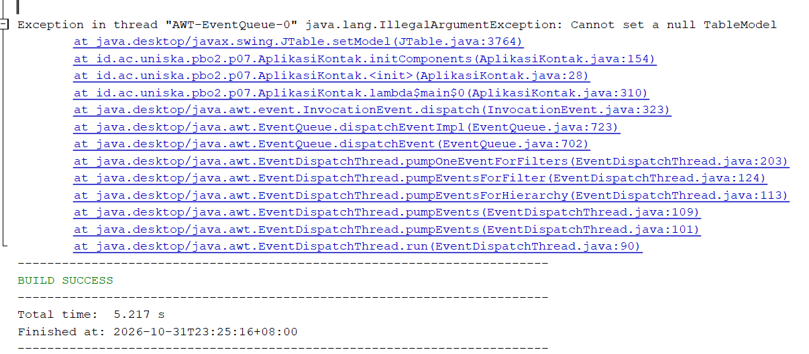

# P07 - Tabel, Menu, dan Mini Proyek: Daftar Kontak

**Mata Kuliah:** Pemrograman Berbasis Objek 2 (TIF1508)
**Pertemuan:** 7 - Tabel, Menu, dan Mini Proyek GUI
**Nama:** Vidia Jauzaa Shadidah
**NPM:** 2410010473

Proyek Maven `p07-tabel-dan-menu` (package `id.ac.uniska.pbo2.p07`) berisi aplikasi Daftar Kontak:

| File | Keterangan |
|---|---|
| `Kategori.java` | Enum kategori kontak |
| `Kontak.java` | Record data satu kontak |
| `KontakTableModel.java` | `AbstractTableModel` yang menghubungkan daftar kontak dengan `JTable` |
| `DialogKontak.java` dan `.form` | JDialog Form modal untuk tambah dan ubah kontak |
| `AplikasiKontak.java` dan `.form` | JFrame Form dengan tabel, menu bar, pencarian, dan status |

## Jawaban Eksperimen Praktikum 5

**Eksperimen 1: mematikan `fireTableRowsInserted`**
Tabel tidak langsung berubah. Data sudah masuk ke daftar di model, tetapi karena fireTableRowsInserted tidak dipanggil, tabel tidak tahu ada baris baru dan tidak menggambar ulang. Model wajib memberi tahu tabel dengan method fireTable... setiap data berubah.

**Eksperimen 2: `barisTerpilih` tanpa `convertRowIndexToModel`**
Yang muncul di dialog konfirmasi adalah nama Budi Santoso, padahal yang dipilih Ahmad Fauzi. Setelah disaring, Ahmad Fauzi berada di baris tampilan 1, sedangkan di model ia berada di baris 2. Tanpa convertRowIndexToModel, nomor baris tampilan dipakai langsung sebagai nomor baris model sehingga kontak yang salah yang diambil, dan jika dikonfirmasi, kontak yang salah terhapus.

**Eksperimen 3: dialog tidak modal**
Jendela utama tetap bisa diklik saat dialog terbuka. Kontak yang ditambahkan tidak masuk ke tabel. Pada dialog tidak modal, setVisible(true) tidak menunggu dialog ditutup, sehingga tampilkan() langsung mengembalikan hasil yang masih null dan tambah() tidak menambah apa pun. Dialog tambah dan ubah dibuat modal agar hasil isian sudah tersedia saat method tampilkan() kembali.

**Eksperimen 4: Ctrl+N, Ctrl+E, Ctrl+D**
Ctrl+N bekerja kapan saja, sedangkan Ctrl+E dan Ctrl+D tidak bekerja saat tidak ada baris yang dipilih. Method perbaruiTombol() menonaktifkan ubahItem dan hapusItem dengan setEnabled(false) ketika kontakTable.getSelectedRow() bernilai kurang dari 0. Item menu yang nonaktif tidak merespons klik maupun pintasan keyboard (accelerator). Setelah satu baris dipilih, item diaktifkan lagi dan pintasannya bekerja.

**Eksperimen 5: accelerator Delete tanpa Ctrl**
Yang berubah adalah baris hapusItem.setAccelerator(...) di initComponents(). Sebelumnya KeyStroke.getKeyStroke(KeyEvent.VK_D, InputEvent.CTRL_DOWN_MASK), sesudahnya KeyStroke.getKeyStroke(KeyEvent.VK_DELETE, 0). Kode ini ditulis NetBeans dari pengaturan di tab Design, tidak diketik sendiri.

**Eksperimen 6: atribut `model` dibuat setelah `initComponents()`**
Jendela tidak terbuka, dan jendela Output menampilkan error 
`at java.desktop/javax.swing.JTable.setModel(JTable.java:3764)
at id.ac.uniska.pbo2.p07.AplikasiKontak.initComponents(AplikasiKontak.java:154)
at id.ac.uniska.pbo2.p07.AplikasiKontak.<init>(AplikasiKontak.java:28)
at id.ac.uniska.pbo2.p07.AplikasiKontak.lambda$main$0(AplikasiKontak.java:310)
at java.desktop/java.awt.event.InvocationEvent.dispatch(InvocationEvent.java:323)
at java.desktop/java.awt.EventQueue.dispatchEventImpl(EventQueue.java:723)
at java.desktop/java.awt.EventQueue.dispatchEvent(EventQueue.java:702)
at java.desktop/java.awt.EventDispatchThread.pumpOneEventForFilters(EventDispatchThread.java:203)
at java.desktop/java.awt.EventDispatchThread.pumpEventsForFilter(EventDispatchThread.java:124)
at java.desktop/java.awt.EventDispatchThread.pumpEventsForHierarchy(EventDispatchThread.java:113)
at java.desktop/java.awt.EventDispatchThread.pumpEvents(EventDispatchThread.java:109)
at java.desktop/java.awt.EventDispatchThread.pumpEvents(EventDispatchThread.java:101)
at java.desktop/java.awt.EventDispatchThread.run(EventDispatchThread.java:90)`.

`initComponents()` dipanggil di awal konstruktor dan menjalankan `kontakTable.setModel(model)` dari Custom code. Saat itu `model` masih `null` karena baru dibuat setelah `initComponents()`, sehingga `JTable` menolaknya. Karena itu atribut `model` harus sudah dibuat saat dideklarasikan, sebelum `initComponents()` berjalan.

## Deklarasi Penggunaan AI

Saya menggunakan **Claude (Anthropic)** untuk memahami langkah pengerjaan berdasarkan modul, membantu menyusun dan menyesuaikan kode dengan nama komponen pada form saya, dan menjelaskan hasil eksperimen. Seluruh kode saya jalankan dan uji sendiri, dan jawaban eksperimen berdasarkan hasil yang saya lihat pada aplikasi.
